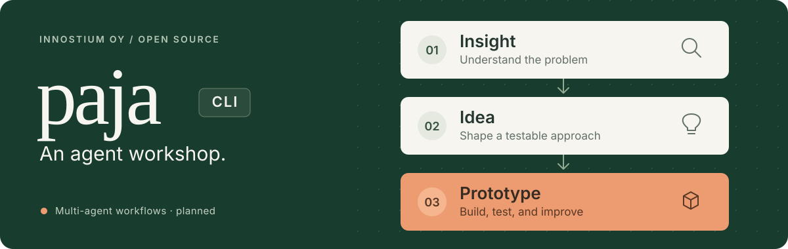

# Paja CLI

**Insight → Idea → Prototype.**

An open-source project of **Innostium Oy**, written in Rust. Paja is being built for **multi-agent workflows** that turn an observed problem into a testable idea and a runnable agent prototype, with decisions, versions, and evidence connected across the journey.

The development loop: **Build, test, and improve your AI agent.**

*Rakenna, testaa ja kehitä tekoälyagenttiasi.*

[The pipeline](#from-insight-to-prototype) · [Multi-agent workflows](#multi-agent-workflows) · [Quick start](#quick-start) · [CLI reference](docs/CLI.md) · [Roadmap](docs/ROADMAP.md)

> [!IMPORTANT]
> **Local control prototype.** Today, the complete loop runs a deterministic meal-helper fixture. It demonstrates versioning, frozen tests, and bounded improvements. Generating or improving a real AI agent and authenticated worker collaboration are still unimplemented. Voice recognition is real; the target agent remains a fixture.

## From insight to prototype

The intended workflow has three stages:

| Stage | The question | The output |
| :--- | :--- | :--- |
| **Insight** | What problem have we observed, and what evidence supports it? | A problem brief with observations, context, and open questions |
| **Idea** | What could an agent do, and how would we know it helped? | A proposed approach, allowed tools, constraints, and success criteria |
| **Prototype** | Does the proposed agent work on the task? | A runnable version, test evidence, and a bounded improvement |

The planned workflow keeps the reasoning behind the idea connected to the prototype and its results. Here, a prototype means a **versioned AI agent**. See the [product direction](docs/PRODUCT.md#insight--idea--prototype) and [generation design](docs/GENERATION.md).

## Multi-agent workflows

Planned development workers collaborate on the same target through one coordinator:

- A **builder** turns the selected idea into a proposed agent version.
- A **tester** evaluates that version against independently authorized, frozen cases.
- A **reviewer** examines failures and regressions and recommends the next bounded change.

Workers would have separate credentials, scoped tasks, and private immutable inputs. The coordinator would accept their handoffs against the correct version and retain the evidence. The owner sets the goal and permissions. See the [proposed worker protocol](docs/AGENT_PROTOCOL.md).

These are agents helping **develop** the prototype. Specialist agents collaborating inside the prototype's runtime are a separate design choice. Neither collaboration layer is implemented yet; the example below demonstrates the owner-operated control loop.

## Quick start

From this source checkout, with [rustup](https://rustup.rs/) installed:

```sh
# Build the CLI.
cargo build --release --locked
export PATH="$PWD/target/release:$PATH"

# Give the agent a job and build its first version.
paja init meal-helper --goal "Help people choose lunches within their budget"
cd meal-helper
paja build

# Try it, find a failure, and compare one bounded improvement.
paja run --input "Choose two lunches for a total of eight euros"
paja test
paja improve
paja results
paja run --input "Choose two lunches for a total of eight euros"
```

Rust **1.99.1** and edition **2024** are pinned. The first build downloads dependencies; running this fixture needs no network, credentials, or provider spending. See the [complete walkthrough](docs/LOCAL_CONTROL.md) for retained versions, edited tests, and recovery.

### See the difference

The fixture's first version picks lunches over budget. One deterministic repair changes the selection strategy, then reruns the same frozen tests.

| What you observe | Before | After |
| :--- | :--- | :--- |
| Selected lunches | Soup + wrap | Soup + soup |
| Total against an €8 limit | **€11 — over budget** | **€8 — within budget** |
| Passing control trials | 2 of 4 | 4 of 4 |
| Baseline evidence | Recorded | Preserved |

These are **control-fixture results, not AI quality measurements**. A candidate that regresses stays available for inspection and does not become current.

## Try it your way

| Interface | Get started | Speech processing |
| :--- | :--- | :--- |
| **Terminal** | Run the [quick start](#quick-start) | Typed input; no speech model needed |
| **Browser** | Open [paja.innostium.com](https://paja.innostium.com) and ask a maintainer for an access key | On the operator's server |
| **Native Mac** | Follow the [Mac setup](docs/VOICE.md#native-mac-app) | Locally on your Mac |

In either voice companion, record a short English or Finnish prompt, review the transcript, and create a project. Then try **Build → Test → Improve → Results**, or choose the lunch example and **Run prompt**. Use synthetic prompts in the hosted demo.

Both companions use the same Rust coordinator and fixture. The browser source, server transcription, tests, and Docker setup live in the separate private [paja-web repository](https://github.com/RHolappa/paja-web) (repository access required). The CLI and Mac app remain here. Read [native voice privacy and scope](docs/VOICE.md#privacy-and-scope); browser data handling is documented in Paja Web.

## What the loop gives you

- **Inspectable versions.** Build freezes a package; run invokes a retained version immediately.
- **Evidence behind every result.** Tests retain actual outputs, tool observations, failures, and usage.
- **Bounded changes.** Improve attempts one supported fixture repair against the locked suite and preserves the baseline.
- **Human and machine interfaces.** Status and results explain the current evidence; versioned `--json` responses include explicit identities and retry keys.

The current implementation supports one local filesystem owner. SQLite transactions, content digests, and standard file locks protect the control loop. The fixture runtime has no network, credentials, arbitrary code, or external tool effects. See [architecture](docs/ARCHITECTURE.md) for the implemented boundaries.

## Explore the project

| Start here | What you'll find |
| :--- | :--- |
| [CLI reference](docs/CLI.md) · [Local walkthrough](docs/LOCAL_CONTROL.md) | Commands, JSON output, and the complete fixture loop |
| [Product](docs/PRODUCT.md) · [Generation](docs/GENERATION.md) | The intended problem-to-agent experience |
| [Architecture](docs/ARCHITECTURE.md) · [Worker protocol](docs/AGENT_PROTOCOL.md) | Current internals and proposed collaboration |
| [Roadmap](docs/ROADMAP.md) · [Decisions](docs/DECISIONS.md) | Next implementation steps and design choices |
| [Validation](docs/VALIDATION.md) | Executed checks, measured performance, and known limits |

The **target agent** is the versioned program being developed. **Workers** are separately authenticated coding, testing, or reviewing agents; worker collaboration remains a proposal. One real generation/runtime adapter is the next step toward useful AI behavior.

Runnable starter inputs: [agent specification](examples/agent.json) and [test suite](examples/cases.json). The [status example](examples/status.json) illustrates the current response with a synthetic project ID.

## Develop and contribute

```sh
cargo fmt --all -- --check
cargo clippy --locked --all-targets -- -D warnings
cargo test --locked
python3 scripts/check_repository.py
```

Normal tests use synthetic fixtures. Live target-model tests require a future adapter, explicit credentials, and bounded authorization. Companion checks are documented in [Voice](docs/VOICE.md#native-development-checks).

Read [Contributing](CONTRIBUTING.md) for a focused first change, [Governance](GOVERNANCE.md) for review, and [Security](SECURITY.md) for private reporting. Publication and executable releases follow [Releasing](docs/RELEASING.md).

---

A project of **Innostium Oy** · [Apache License 2.0](LICENSE) · [Attribution](NOTICE) · [Code of conduct](CODE_OF_CONDUCT.md)
