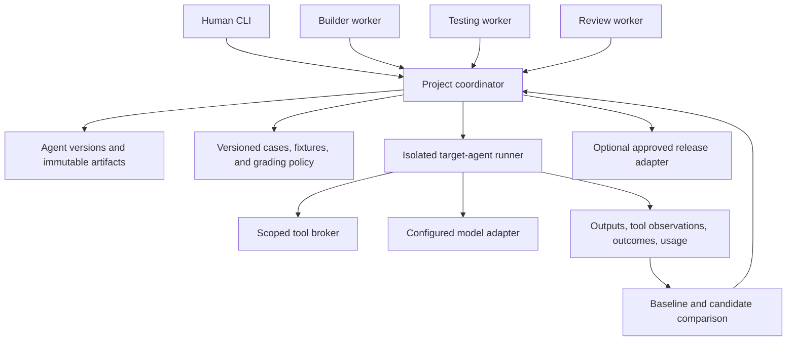

# Architecture

Paja coordinates the development of a target AI agent. Human users and worker agents share one authority for versions, tasks, runs, and accepted evidence. The local owner/control subset below is implemented; the worker, model, isolation, and release architecture remains the intended design.

## Implemented local control

A single Rust package contains CLI parsing, the coordinator engine, strict serde input contracts, SQLite storage, the fixture runtime, and host assertions. `src/engine.rs` is the shared transition authority for human and JSON callers. A standard-library exclusive file lock serializes owner processes; another process receives a retryable busy result. There is no daemon or worker IPC yet.

SQLite transactions commit candidate changes, append-only packages/runs, and retry receipts together with synchronous=FULL. Package and run digests detect accidental corruption; immutable-table triggers reject accidental updates. These are integrity checks, not authentication against a filesystem owner who can rewrite the database. State lives in a private `.paja` directory (0700 on Unix). No secrets or provider configuration are stored.

Runs are short and synchronous. The runtime is a fixed Rust function receiving only declared fixture inputs and tool policy. It does not execute arbitrary target code, processes, filesystem operations, network requests, or model calls. This makes the control example safe to run but does not establish an isolation boundary for future untrusted code. Trials have stable IDs under their run and enforce trial, tool-call, and elapsed-time limits. A completed request retry replays its stored response.

Build snapshots the specification and default suite. Test may select an explicit owner-authored suite and freezes it into its run. Improve operates on the stored baseline and suite, changes only supported runtime fields, preserves the baseline, and retains rejected candidates. Comparability includes suite, repetitions, evaluator, runtime/model identity, tools, and budget settings. Fixture integer cents avoid floating-point price comparisons.

The release profile enables thin LTO and one code-generation unit. Fixed input bounds and direct synchronous execution keep the first runtime small; performance measurements and limitations are in [Validation](VALIDATION.md). No async runtime, distributed coordination, or parallel-worker capacity is claimed.

## Voice clients

The [native Mac companion](VOICE.md) in this repository and the browser companion in the separate private [paja-web repository](https://github.com/RHolappa/paja-web) are owner clients of the same Rust executable. They invoke fixed command argument arrays, hand reviewed prompts over through private UTF-8 files, and use the coordinator's project IDs, revisions, frozen tests, and request receipts. They never open its SQLite database directly. `paja identity` discovers a local owner's project identity without changing state.

The native SwiftUI app uses AVFoundation for bounded recording and WhisperKit for local speech recognition. Model setup is explicit. The browser records and resamples a short clip locally, then sends a mono WAV over HTTPS to its own server. A single-owner Python service validates the audio and runs faster-whisper in a bounded subprocess; its model assets are provisioned separately. Neither transcription adapter is a target-agent runtime or a development worker.

Paja Web owns its Docker setup and stores project directories and model assets in a persistent volume. One web process owns expiring owner sessions; coordinator file locks serialize actual state changes. Caddy terminates HTTPS. Native and cloud project stores are independent; there is no automatic synchronization, multi-user tenancy, or worker authentication.

## Target generation architecture

The problem specification is an input to a generation adapter, which proposes instructions, tool wiring, and a runnable package. The coordinator validates the proposal and owns its accepted version. The [generation design](GENERATION.md) makes this the user-facing purpose of the build path. Problem-specific test proposals require separate authority before becoming frozen evaluation inputs.

If runtime specialist collaboration is selected, those specialists belong inside the versioned target and its bounded runner. They are distinct from builder/tester/reviewer workers in the diagram and cannot control the development coordinator or evaluator. Neither collaboration layer is implemented yet.

## Responsibilities

| Component | Owns |
| --- | --- |
| CLI | Goal intake, understandable progress, explicit machine requests, and contract discovery |
| Coordinator | Candidate versions, task graph/leases, scoped authority, run budgets, operation receipts, and optional release approval |
| Build adapter | Turn the versioned problem and allowed capabilities into inspectable instructions/configuration and supported code through a configured generation backend; propose a candidate package |
| Target runner | Execute a frozen agent version on a manual task or test case with bounded resources |
| Tool/model adapters | Enforce available capabilities and credentials, separate fixtures from live calls, and report usage/uncertainty |
| Evaluator | Host assertions, separately configured model assessments, test-run provenance, and regression comparison |
| Artifact store | Immutable inputs/outputs, package manifests, suites, traces, and selected exports |

A target agent and a worker have different identities and permissions. The target cannot claim development tasks or alter the coordinator. A worker does not inherit the target's live tool credentials or gain release permission by finishing a task.

## First runtime

Begin with one local coordinator, SQLite/private artifact files, one starter agent package, and a deterministic fixture adapter for control tests. Workers connect through authenticated local IPC and never write the database directly.

Add one explicitly configured real model/runtime adapter before claiming useful AI behavior. The adapter must expose input/output and tool contracts, termination, usage accounting gaps, and unsupported capabilities. Fixture responses are labelled; missing real configuration never silently falls back to synthetic success.

Several machines require one authenticated reachable coordinator and encrypted transport. Do not synchronize SQLite files or run competing authorities. Measure storage contention, latency, throughput, and recovery before expanding topology.

## Immutable inputs and bounded work

A candidate identifies instructions, code/dependencies, declared tools, model/runtime configuration, and package digest. Test suites, fixtures, and graders are separately versioned inputs. A run freezes both sets and records requested/resolved model identifiers when available. Matching inputs do not guarantee identical model output.

Builder outputs are separate proposals. Accepting a new current candidate requires an expected-revision check; other workers' files are never patched underneath them. Tests for retained versions may finish into their own historical run, but cannot verify a different candidate. Task leases and generations fence expired or reassigned workers.

The coordinator stores input identities and request receipts before dispatch. Identical retries reuse work. A replacement worker inherits completed step receipts, not a fresh budget or permission to repeat uncertain paid actions. Unknown provider outcomes are visible and must be reconciled or explicitly accepted before new work.

## Safe target execution

Target code and model-generated tool requests are untrusted. Enforce process, filesystem, network, time, call, token, and applicable spending limits outside that code. Provider credentials stay in trusted adapters; target inputs receive only declared data and capabilities.

Default suites use deterministic tool fixtures. Real external actions require explicitly granted tools and action-specific authorization where consequential. A request in the target's instructions cannot expand its allowlist. Cancellation fences future commits and further calls; already issued provider requests may still complete or incur usage.

Do not infer successful execution from a model-written report. The runner records actual tool requests/results and output artifacts. Expected assertions and grading policy remain outside the target's writable environment.

## Tests and improvement

Host assertions check observable outputs/actions. Optional model graders are separately configured, versioned, and labelled as judgments. Provider errors, missing fixtures, and exhausted budgets remain failed/blocked work, never passing cases.

An improvement run references a baseline test run, the failures authorized as feedback, a fixed suite/fixture/grader version, and a bounded attempt count. It proposes a new candidate, then evaluates under comparable conditions. If needed, rerun the baseline under those conditions; retain earlier evidence separately.

Do not let improvement workers edit or remove difficult cases. Separately authorized test changes create a new suite and require a fresh comparison of both agent versions. Held-out cases, if used, have separate access from builder feedback. Report all case outcomes, repeated-trial variation, regressions, latency, and known usage. Incompatible settings produce a non-comparable result rather than an improvement claim.

A failed improvement preserves the baseline and proposed artifacts for inspection. A new candidate does not replace an approved/public release automatically.

## Evidence and optional release

Traces may contain private task inputs and tool output. Define retention/deletion, redact credentials, and require explicit selection before exporting private data or adopting real user input as a fixture. Fixture tests, live model evaluations, manual trials, and production observations have distinct provenance.

Optional publication binds the exact package, runtime/model settings, tool permissions, verified test evidence/policy, target, limits, authorized publisher, and expiry. Concurrent requests reserve one activation record and reuse its receipt. An adapter cannot change approved bytes or granted tools after review.

The local build/test/improve loop must work before a deployment adapter is required. No event collector, recruitment workflow, or static hosting platform is part of the core architecture.

## Reused interface patterns

[Explicit CLI JSON](https://cli.github.com/manual/gh_help_formatting), [frozen plans](https://developer.hashicorp.com/terraform/cli/commands/apply#saved-plan-mode), [idempotent requests](https://docs.stripe.com/api/idempotent_requests), and [versioned updates/watches](https://kubernetes.io/docs/reference/using-api/api-concepts/) inform the proposed boundaries. These references are not implementation dependencies or evidence of Paja behavior. See [Agent protocol](AGENT_PROTOCOL.md).
